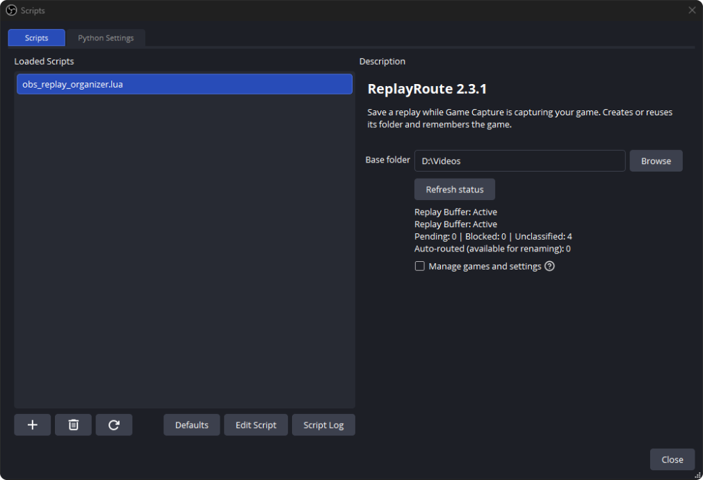
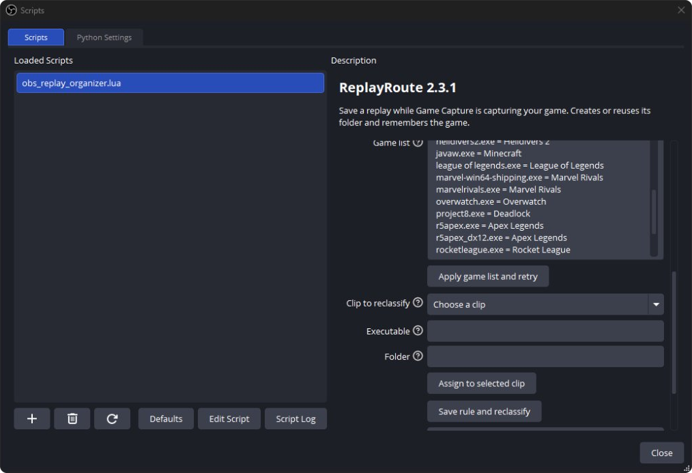

<div align="center">
  <br>
  <p>
    
  </p>
  <h1>ReplayRoute</h1>
  <p>
    <a href="README.md">English</a> · <b>Español</b>
  </p>
  <p>
    <b>Guarda el replay. Mantenlo ordenado.</b><br>
    Script Lua ligero para <b>OBS Studio en Windows de 64 bits</b> que organiza tus clips del Búfer de Reproducción en carpetas por juego — sin abrir consolas, lanzar procesos externos ni conectarse a internet.
  </p>
  <p>
    <a href="#versiones-y-descarga"></a>
    
    <a href="LICENSE"></a>
    
  </p>
  <p>
    <a href="https://github.com/Rena148/ReplayRoute/releases/latest/download/obs_replay_organizer.lua"></a>
    <a href="https://github.com/Rena148/ReplayRoute/archive/refs/tags/v2.3.1.zip"></a>
  </p>
  <p>
    <sub>Solo necesitas <code>obs_replay_organizer.lua</code> para usarlo en OBS Studio · <a href="#versiones-y-descarga">Versiones y archivos directos</a></sub>
  </p>
  <p>
    <a href="#características">Características</a> ·
    <a href="#versiones-y-descarga">Descarga</a> ·
    <a href="#inicio-rápido">Inicio rápido</a> ·
    <a href="#gestión-de-juegos-y-clips">Gestionar juegos</a> ·
    <a href="#comportamiento-y-límites">Comportamiento y límites</a> ·
    <a href="#pruebas">Pruebas</a> ·
    <a href="docs/GUIDE.es.md">Guía de usuario</a>
  </p>
</div>

<br>

<p align="center">
  
  <br>
  <sub>Panel principal en OBS Studio con el estado del Búfer de Reproducción, contadores y controles avanzados ocultos.</sub>
</p>

<br>

<table>
  <tr>
    <td width="25%" valign="top">
      <h3>🎮 Detecta Game Capture</h3>
      Lee el ejecutable activo directamente desde los hooks visibles de Game Capture (incluso en pantalla completa) y conserva el juego hasta 45 segundos tras un Alt-Tab mientras siga abierto.
    </td>
    <td width="25%" valign="top">
      <h3>📁 Carpetas inteligentes</h3>
      Limpia sufijos técnicos (como <code>-Win64-Shipping</code> o <code>_dx12</code>), reutiliza subcarpetas equivalentes ya existentes en <b>Base folder</b> o crea la carpeta automáticamente.
    </td>
    <td width="25%" valign="top">
      <h3>🛡️ Cola segura ante fallos</h3>
      Guarda los movimientos pendientes en JSON persistente, nunca sobrescribe clips existentes, reintenta archivos bloqueados y evita copias lentas entre discos distintos.
    </td>
    <td width="25%" valign="top">
      <h3>⚙️ Todo dentro de OBS</h3>
      Edita tu <b>Game list</b>, reclasifica clips manualmente, limpia carpetas vacías tras renombrar, descarta clips borrados del disco y archiva meses anteriores sin tocar código.
    </td>
  </tr>
</table>

<br>

## Versiones y descarga

ReplayRoute no requiere instalador. **`obs_replay_organizer.lua` es el único archivo que necesita OBS Studio**; las carpetas `docs/` y `tests/` contienen únicamente documentación y pruebas automatizadas.

| Opción de descarga | Contenido | Enlace |
|---|---|---|
| **Solo el script (Recomendado)** | Archivo único `obs_replay_organizer.lua` para OBS (descarga directa en 1 clic desde Releases) | [`obs_replay_organizer.lua` (v2.3.1)](https://github.com/Rena148/ReplayRoute/releases/latest/download/obs_replay_organizer.lua) · [Ver código](https://github.com/Rena148/ReplayRoute/blob/v2.3.1/obs_replay_organizer.lua) |
| **Repositorio completo (`.zip`)** | Paquete completo de `v2.3.1` con guía de usuario, capturas y suite de pruebas en LuaJIT | [`ReplayRoute-v2.3.1.zip`](https://github.com/Rena148/ReplayRoute/archive/refs/tags/v2.3.1.zip) |
| **Releases y versiones anteriores** | Etiquetas publicadas, notas de versión e historial de cambios | [GitHub Releases](https://github.com/Rena148/ReplayRoute/releases) · [Tags](https://github.com/Rena148/ReplayRoute/tags) · [Changelog](CHANGELOG.md) |

### Versiones recientes

- **`v2.3.1`** — Lista predeterminada minimalista (solo Deadlock), limpieza automática de clips `unclassified` y `auto_routed` borrados del disco al abrir/refrescar/reintentar, capturas sin bordes y documentación bilingüe.
- **`v2.3.0`** — Detección nativa de hook en Game Capture (pantalla completa), gracia de 45 s en Alt-Tab validando procesos en Windows, limpieza de sufijos técnicos, reutilización de carpetas existentes, limpieza de carpetas vacías e interfaz compacta en OBS.
- **`v2.2.0`** — Flujo simplificado dentro de OBS para agregar o actualizar reglas.

Consulta [CHANGELOG.md](CHANGELOG.md) para ver el historial completo.

## Inicio rápido

1. Descarga [`obs_replay_organizer.lua`](https://github.com/Rena148/ReplayRoute/releases/latest/download/obs_replay_organizer.lua) (o descarga y extrae [`ReplayRoute-v2.3.1.zip`](https://github.com/Rena148/ReplayRoute/archive/refs/tags/v2.3.1.zip)) en una carpeta fija con permisos de escritura.
2. Abre **OBS → Herramientas → Scripts → `+`** y selecciona `obs_replay_organizer.lua`.
3. Configura **Base folder** en una carpeta local dentro de la **misma unidad y volumen que tus clips originales** (el ejemplo inicial es `D:\Videos`; ajústalo a tu disco).
4. Activa y configura el **Búfer de reproducción** en **OBS → Ajustes → Salida** y asigna un atajo de teclado para guardar replays.
5. Abre un juego capturado con **Game Capture** (*Capturar cualquier aplicación a pantalla completa* o *Capturar ventana específica*), guarda un replay y pulsa **Refresh status** para confirmar adónde se movió.

> [!NOTE]
> Mantén el nombre `obs_replay_organizer.lua` al actualizar para conservar tus ajustes y la cola pendiente. Carga solo una copia del script en OBS.

## Características

- **Sin sobrescrituras:** si ya existe un archivo con el mismo nombre, añade un sufijo numérico (`clip (1).mp4`) y el movimiento nativo Win32 impide reemplazar archivos existentes.
- **Detección por escena y captura:** consulta las fuentes visibles (`Game Capture` y `Window Capture`), incluidos grupos y escenas anidadas.
- **Lista inicial limpia:** solo incluye Deadlock (`project8.exe` / `deadlock.exe`) por defecto; los demás juegos se aprenden solos o se agregan en OBS.
- **Recuperación tras cierres:** la cola persistente (`obs_organizer_state.json` + `.bak`) reconcilia movimientos interrumpidos al volver a abrir OBS.
- **Reintentos acotados:** si un clip sigue ocupado por Windows tras guardarse, reintenta hasta seis veces con espera creciente antes de marcarlo para revisión manual.
- **Mantenimiento automático:** los clips eliminados manualmente desaparecen de **Clip to reclassify** cuando **Base folder** está disponible, y las carpetas vacías sobrantes tras reclasificar se eliminan solas.
- **Inicio automático opcional:** puede solicitar activar el Búfer de reproducción al iniciar OBS.

## Gestión de juegos y clips

<p align="center">
  
  <br>
  <sub>Panel <b>Manage games and settings</b> expandido: editor de reglas, selector de clips y botones de asignación.</sub>
</p>

Con **Auto-create game folders** activado (por defecto), ReplayRoute toma el ejecutable reportado por Game Capture, limpia sufijos técnicos (`-Win64-Shipping`, `_dx12`, etc.), reutiliza una subcarpeta coincidente única que ya exista en **Base folder** (por ejemplo `rocketleague.exe` → `Rocket League`) o crea una carpeta con el nombre limpio y guarda la regla tras completar el movimiento.

Dentro de **Manage games and settings** puedes:

- **Editar varias reglas juntas:** modifica **Game list** (`ejecutable.exe = Carpeta`, una por línea) y pulsa **Apply game list and retry**.

  ```text
  newgame.exe = My Game
  anothergame.exe = Another Game
  ```

- **Renombrar un juego y mover sus clips:** llena **Executable** y **Folder** y pulsa **Save rule and reclassify**. Las subcarpetas automáticas que queden vacías dentro de **Base folder** se eliminan automáticamente.
- **Reclasificar un clip puntual:** elige un archivo en **Clip to reclassify** (ordenados del más reciente al más antiguo, 50 por página; al seleccionarlo se rellena **Executable** si se conoce), escribe una **Folder** y pulsa **Assign to selected clip**.
- **Cerrar seguimiento de meses anteriores:** cuando haya clips auto-clasificados de meses pasados, usa **Finish tracking … older clips** para marcarlos como listos sin mover archivos.
- **Limpiar clips borrados:** si borras manualmente clips `unclassified` o `auto_routed` en Windows, desaparecen de **Clip to reclassify** y del conteo al abrir **Scripts**, desplegar **Manage games and settings**, pulsar **Refresh status** o aplicar reglas (sin tocar nada si tu disco o **Base folder** no está conectado).

## Actualización

Respalda tu `obs_replay_organizer.lua` y `obs_organizer_state.json`. Reemplaza `obs_replay_organizer.lua` en la misma ruta y pulsa **Recargar (`↻`)** en OBS. Tus ajustes, **Base folder** y **Game list** personalizada se conservan intactos. No ejecutes otro organizador al mismo tiempo sobre las mismas carpetas.

## Comportamiento y límites

<details>
<summary>Ver detalles técnicos sobre detección, seguridad y almacenamiento</summary>

- Si Game Capture pierde el hook al hacer Alt-Tab, ReplayRoute recuerda el último ejecutable confirmado en esa fuente hasta 45 segundos dentro de la misma escena mientras el proceso siga activo. Sin hook vivo, también puede usar un objetivo de ventana específica o un juego conocido en primer plano; los casos ambiguos van a la carpeta `Unclassified`.
- Solo se procesan replays nuevos y entradas pendientes en cola; ReplayRoute no escanea tu biblioteca de videos antigua.
- Todos los movimientos ocurren en el mismo volumen local (`MoveFileExW` sin `COPY_ALLOWED`). Las rutas entre discos distintos o en red se bloquean para no congelar OBS copiando archivos grandes.
- La cola registra intención de movimiento (no repara grabaciones corruptas ni fallos de disco) y detiene los movimientos si falla el guardado del archivo JSON.
- La ejecución es por eventos con temporizadores breves, sin sondeo continuo; **Refresh status** actualiza el estado bajo demanda.
- El estado se guarda junto al script en `obs_organizer_state.json` y `obs_organizer_state.json.bak` (excluidos de Git).

</details>

## Pruebas

Requisitos: **Windows x64**, **Python de 64 bits** y **OBS Studio** instalado. Python **solo hace falta para correr las pruebas**, no para usar ReplayRoute.

```powershell
python tests/run_lua.py tests/test_organizer.lua
```

Si instalaste OBS en otra ruta:

```powershell
$env:OBS_BIN = 'E:\Apps\obs-studio\bin\64bit'
python tests/run_lua.py tests/test_organizer.lua
```

La suite corre con LuaJIT y `libobs` reales de OBS usando archivos temporales, enumeración de procesos Win32, bloqueos reales de archivo, señales simuladas de captura/escena y persistencia JSON.

> [!IMPORTANT]
> Las pruebas automatizadas no sustituyen la validación real: comprueba siempre guardar un replay dentro de OBS durante una partida para confirmar el funcionamiento en tu equipo.

## Documentación y licencia

- [Guía de usuario (Español)](docs/GUIDE.es.md) · [User guide (English)](docs/GUIDE.md)
- [Historial de cambios (Changelog)](CHANGELOG.md)
- **Licencia:** [MIT](LICENSE) — Copyright © 2026 Rena148. OBS Studio y LuaJIT no se redistribuyen y mantienen sus licencias originales. ReplayRoute es un proyecto independiente, no oficial de OBS.
