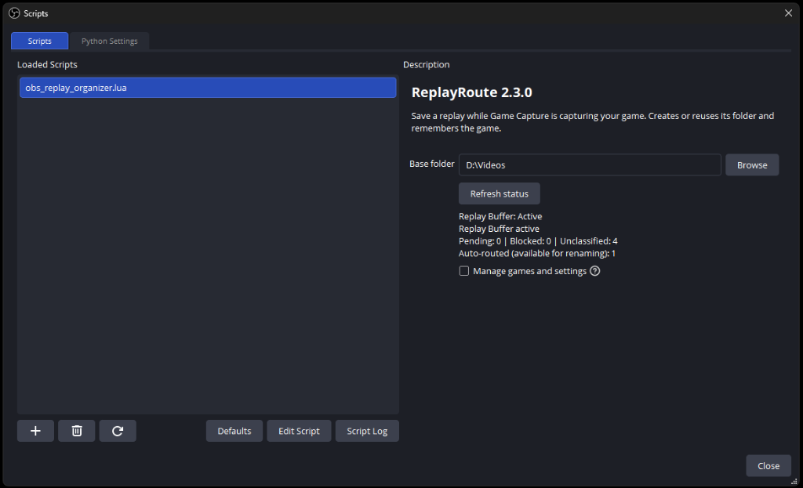

# ReplayRoute

**Save the replay. Keep it organized.**

ReplayRoute sorts OBS Studio Replay Buffer clips into game folders. A single Lua script for **64-bit Windows**, running inside OBS without launching shell processes or console windows.

**Version 2.3.0** · English interface · MIT license · No accounts, network requests, or telemetry.

## Features

- **No overwrites:** filename collisions receive numbered suffixes.
- **Game-aware routing:** asks visible OBS capture sources which executable they are capturing, including in fullscreen games.
- **Automatic folders for new games:** save a replay while Game Capture is capturing `newgame.exe` to create its `newgame` folder and remember it in OBS.
- **Recoverable moves:** a persistent JSON queue tracks pending work across reloads.
- **Bounded retries:** temporary file locks are retried; persistent failures remain available for review.
- **Rules inside OBS:** add, edit, or remove executable-to-folder mappings without editing Lua.
- **Manual reclassification:** assign ambiguous clips to a folder and retry failed moves.
- **Visible status:** check pending items, recent history, and actual Replay Buffer state.
- **Optional auto-start:** request Replay Buffer startup when the script loads.



*Main script panel in OBS Studio with **Manage games and settings** collapsed.*

## Quick start

1. Download this repository using **Code → Download ZIP** and extract it to a writable folder.
2. Open **OBS → Tools → Scripts → +** and select `obs_replay_organizer.lua`.
3. Set **Base folder** to a local folder on the **same drive as your original clips**. The initial example is `D:\Videos`; change it to match your computer.
4. Enable and configure Replay Buffer in **Settings → Output**, and assign a hotkey to save replays.
5. Open a game with Game Capture set to **Capture any fullscreen application** or **Capture specific window**. Save a replay and click **Refresh status** to see where it went.

The Lua filename is intentionally unchanged for compatibility with existing installations. Load only one copy of the script.

## Add a game

After the first successful move, ReplayRoute adds the detected executable to your OBS game list. Open **Manage games and settings** to edit folder names, add games manually, or retry clips.

**Auto-create game folders** is enabled by default. When Game Capture detects an unregistered game, ReplayRoute strips common technical executable suffixes (such as `-Win64-Shipping` or `_dx12`), reuses an unambiguously matching existing subfolder in **Base folder** (for example `rocketleague.exe` → `Rocket League`), or creates a folder from the cleaned executable name. Existing rules take priority. Multiple conflicting targets, unsafe folder names, and unknown foreground windows do not trigger automatic folder creation.

To rename a game's folder for future and tracked clips, enter its executable and the new folder, then click **Save rule and reclassify** (empty automatic folders left behind after moving all clips are cleaned up automatically). To finish tracking older clips in their current folders, use the action for previous months under **Manage games and settings**.

You can also edit several rules in **Game list** and click **Apply game list and retry**. Edits take effect together when you apply them.

```text
newgame.exe = My Game
anothergame.exe = Another Game
```

To correct a single clip, select **Clip to reclassify**, enter a folder, and click **Assign to selected clip**. Selecting a clip fills in its executable when available.

## Updating

Back up the existing Lua file and queue JSON. Replace the Lua file in the same location, then click **Reload** in OBS. Existing settings and game rules remain compatible, including custom folder names. Older queue entries may retain their original log language until processed.

Do not run another organizer on the same clips at the same time.

## Behavior and limits

- If Game Capture loses its hook after Alt-Tab, ReplayRoute can use the last confirmed game for up to 45 seconds in the same scene while the process is running. With no live hook, a specific-window Game Capture target or a recognized foreground game can also identify the clip. Ambiguous clips go to your unclassified folder.
- Only new replay events and saved queue entries are processed. ReplayRoute does not scan an existing video library.
- Moves stay on the same local drive. Cross-drive copies and network destinations are blocked to avoid long copy operations inside OBS.
- The queue records moves; it is not a video backup and cannot repair incomplete recordings or disk failures.
- If queue storage fails, moves pause. A failed move leaves the source file in place when it has not already moved.
- Event-driven processing reduces unnecessary work, but is not zero-cost or background-thread execution. Same-volume moves are normally quick, not instantaneous.
- Click **Refresh status** to update the panel; it does not refresh continuously.

Runtime state lives beside the script in `obs_organizer_state.json` and its `.bak` backup. These files can contain local paths and are excluded from Git.

## Tests

Requirements: Windows x64, 64-bit Python, and OBS Studio installed. Python is **only required for tests**, not to use ReplayRoute.

```powershell
python tests/run_lua.py tests/test_organizer.lua
```

For a custom OBS installation:

```powershell
$env:OBS_BIN = 'E:\Apps\obs-studio\bin\64bit'
python tests/run_lua.py tests/test_organizer.lua
```

The suite uses installed LuaJIT/libobs, real temporary file moves, Windows process enumeration and JSON persistence. It simulates OBS capture, scene and UI events. Coverage includes fullscreen detection, Alt-Tab expiry, hidden and nested sources, staged rule edits, older clip tracking, collisions and interrupted moves.

**Still requires real-world validation:** saving a replay inside OBS and measuring performance during gameplay. Passing the tests does not establish that the project is fault-proof.

[User guide](docs/GUIDE.md) · [Changelog](CHANGELOG.md)

## License

MIT. Copyright © 2026 Rena148. OBS and LuaJIT are not redistributed and retain their respective licenses. ReplayRoute is an independent project, not an official OBS plugin.
